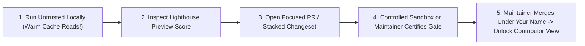

# Contributing to Smithers CI

We welcome public contributions on [smithers.sh/smithersai/smithers-ci](https://smithers.sh/smithersai/smithers-ci) and our GitHub mirror at [github.com/smithersai/smithers-ci](https://github.com/smithersai/smithers-ci).



## Untrusted Community Runs Are Encouraged

You do not need special credentials to test, replay, or audit changes.

```sh
bun install
bun run fast-check
bun run audit:untrusted
```

- **Fast warm cache reads:** Community runs read trusted cache hits from `https://build.smithers.sh`.
- **Safe isolation by construction:** Untrusted runs store artifacts in `untrusted/<actor>/<sha>/` and cannot write to the shared cache or satisfy merge gates.
- **Contributor personalization:** As soon as your first commit, pull request, or accepted issue lands (`contributions >= 1`), the Smithers CI factory automatically upgrades your workspace from Viewer to Contributor.

## Bring Your Own Agent via Cloud MCP

Connect Claude Code, Codex, Antigravity, or Cursor to:

```text
https://smithers.sh/smithersai/smithers-ci/mcp
```

Agents can inspect the repo, run Lighthouse previews, search the wiki, read Mythical History, draft TODOs, open issues, and propose stacked changesets. People review and merge. Agents never approve or merge.
