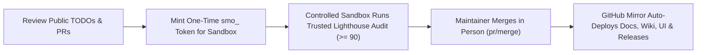

# Maintainer Guide

Maintainers (`roninjin10`) operate the public Smithers Cloud factory, certify trusted sandbox runs, mint one-time sandbox tokens, and merge stacked changesets to trigger automated docs publishing and releases.



## Minting One-Time Sandbox Authentication

Never hand long-lived credentials to a container or external agent. Mint a single-use `smo_` token that burns atomically on first exchange:

```sh
node --experimental-strip-types bin/smithers-ci.mjs auth mint \
  --subject sandbox:cfbox-01 \
  --tier trusted:sandbox \
  --ttl 300 \
  --out .smithers/tokens/cfbox-01
```

This creates a mode-600 token file and companion `.json` scope receipt. Person-only actions (`pr/merge`, `todo/commit`, `release/publish`, `secrets/write`) are stripped automatically at mint time and refused with `403 person_only` at runtime.

## Automated Mirror Releases

Merging on Smithers Cloud pushes to GitHub `main`, which triggers `.github/workflows/smithers-mirror-release.yml`:

1. Runs `bun run full-check` with trusted cache credentials.
2. Uploads the Lighthouse Backpressure Audit report to GitHub Actions and the shared object store.
3. Builds and deploys the personalized Factory UI, Obsidian wiki, and Cloud MCP Worker to Cloudflare.
4. Cuts an npm release with provenance and a GitHub Release whenever a `v*` tag is pushed.
