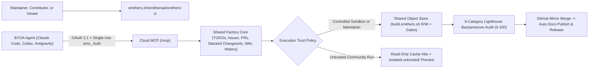

# Smithers CI

Fast kernel-recorded incremental CI, Lighthouse backpressure audits, authenticated Cloud MCP, Obsidian Wiki, and Mythical History built publicly on [Smithers Cloud](https://smithers.sh/smithersai/smithers-ci).



## Quickstart

```sh
# Install dependencies and verify strict types + security tests
bun install
bun run fast-check

# Run the 6-category Lighthouse backpressure audit (HTML + JSON)
bun run audit

# Run an untrusted community preview (encouraged, isolated from cache writes)
bun run audit:untrusted

# Mint a single-use sandbox authentication token (mode-600 file or bootstrap print)
node --experimental-strip-types bin/smithers-ci.mjs auth mint --subject sandbox:cfbox-01 --tier trusted:sandbox

# Start the local Streamable HTTP Cloud MCP server
bun run mcp:serve

# Launch the personalized Factory and Lighthouse Web UI
bun run dev:ui
```

## Core Architecture

- **Shared Smithers Cloud Object Store (`src/store/ObjectStore.ts`):** Content-addressed `/ac` and `/cas` remote cache (`https://build.smithers.sh`) plus R2 artifact storage (`http://artifacts.smithers.internal`). Every read verifies SHA-256 integrity.
- **Three-Tier Execution Trust (`src/trust/ExecutionTrust.ts`):** Accepts gate-clearing results and shared cache writes only from verified maintainers (`roninjin10`) or attested Smithers sandboxes (`cfbox-*`, `gate-*`, `nyc-01-*`, `nyc-02-*`). Community contributors are actively encouraged to run untrusted checks locally and on PRs with full warm-cache reads, while structurally prevented from poisoning the cache or skipping gates.
- **Lighthouse Backpressure Audit (`src/audit/AuditEngine.ts` + `LighthouseHtml.ts`):** Grades every run from 0 to 100 across six weighted categories (Correctness, Cache & Speed, Security & Trust, Formal & Fuzz Assurance, Wiki & Docs Freshness, and Release & Cloud Readiness) with animated SVG gauges, timing waterfalls, and root-input tracing.
- **Authenticated Cloud MCP & One-Time Sandbox Auth (`src/auth/OneTimeToken.ts` + `src/mcp/McpServer.ts`):** Exposes 20 Streamable HTTP MCP tools for artifacts, TODOs, issues, PRs, stacked changesets, wiki, and mythical history. Mints single-use `smo_` tokens stored strictly as SHA-256 digests with PKCE S256 and hard person-only boundaries.
- **Personalized Coding Factory UI (`app/` + `.smithers/home.json`):** Tailored as a product manager for Maintainers, Contributors (anyone with at least 1 contribution), and Viewers.
- **Obsidian Wiki & Mythical History (`wiki/` + `history/`):** Nine visual-first wiki pages with verified backlinks plus a deterministic linear Mythical History folding real commits.

## Documentation

- [Architecture Wiki](wiki/index.md)
- [Execution Trust & Isolation](wiki/trust-and-isolation.md)
- [Lighthouse Backpressure Audit](wiki/lighthouse-backpressure.md)
- [Cloud MCP & One-Time Auth](wiki/mcp-and-one-time-auth.md)
- [Contributing Guide](CONTRIBUTING.md)
- [Maintainer Guide](MAINTAINERS.md)
