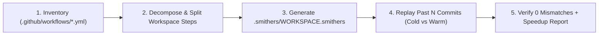

# Incremental Replay Pipeline

Before adopting Smithers CI, a team runs `bunx smithers-ci --commits 4` on their existing repository. Nothing in the working tree is modified. Smithers CI replays real historical commits side by side in baseline mode and incremental cached mode, then prints exact wall time, CPU time, and mismatch counts.

## Measured Real-World Proof

- **smithersai/smithers-ci-example:** 4 commits replayed with 0 mismatches. Docs-only edits drop from 12.9s to 2.9s (4.4x faster, 4 of 4 steps reused). Multi-package code edits drop from 53.3s to 40.6s (1.3x faster).
- **smithersai/needlefish:** 25 jobs inventoried, 0 apply refusals, 0 replay mismatches under native `smthrs-observe`.
- **elizaOS/eliza (untrusted Cloudflare Sandbox):** Executed exclusively inside an isolated `cfbox` microVM with zero host clone, zero host secrets, and zero shared caches. Exited 0 with 0 mismatches under `6.18.64-cloudflare-microvm` and `bwrap 0.8.0`.

## Related Pages

- [[kernel-observer]]
- [[trust-and-isolation]]
- [[lighthouse-backpressure]]
- [[index]]
