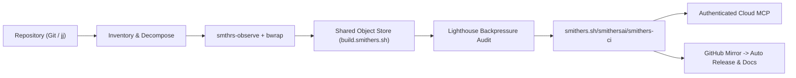

# Smithers CI Architecture Overview

Smithers CI reads the CI workflows a repository already uses, records exact file reads at the Linux kernel boundary, caches exact verdicts in a shared Smithers Cloud object store, and measures real speedup before a team changes a single file.

Every part of this repository runs publicly on Smithers Cloud at `smithers.sh/smithersai/smithers-ci` and mirrors to GitHub at `github.com/smithersai/smithers-ci`.

## Navigate This Wiki

- [[kernel-observer]] explains how `smthrs-observe` captures every read, stat, and exec under bubblewrap with zero stale passes.
- [[incremental-replay]] walks through the four-stage pipeline from workflow inventory to replay verification.
- [[shared-object-store]] documents the content-addressed `/ac` and `/cas` remote cache plus R2 artifact storage.
- [[trust-and-isolation]] defines our three execution trust tiers so community contributors run freely without poisoning the cache or skipping gates.
- [[lighthouse-backpressure]] explains the six-category 0 to 100 Lighthouse backpressure audit report.
- [[mcp-and-one-time-auth]] details the Cloud MCP server, OAuth 2.1 PKCE discovery, and single-use `smo_` sandbox tokens.
- [[release-and-mirror]] covers automated releases, docs publishing, and wiki refreshes triggered when Smithers Cloud merges to GitHub.
- [[formal-verification]] summarizes our 387 Lean 4 theorems, differential fuzzing, and adversarial test suites.
