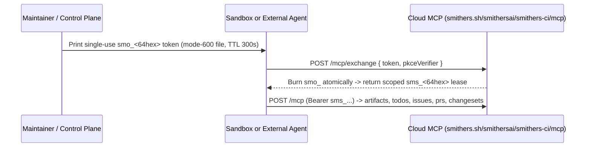

# Cloud MCP Server and One-Time Sandbox Auth

Every coding agent (Claude Code, Codex, Antigravity, Cursor) interacts with `smithers-ci` through our public Streamable HTTP MCP server at `https://smithers.sh/smithersai/smithers-ci/mcp`.

## One-Time-Use Authentication for Sandboxes

Long-lived static API keys leak easily inside ephemeral containers. Instead, Smithers Cloud prints a **single-use, scope-attenuated bootstrap token** (`smo_<64hex>`) for every sandbox or agent session:

- **Stored as SHA-256 digest only:** Raw tokens never touch persistent storage, audit tables, or logs.
- **Atomic burn on redemption:** The first exchange marks `redeemedAt` before issuing a short-lived `sms_` session lease. Any replay returns `already_redeemed`.
- **Automatic scope intersection:** Requesting `cache:write` on an `untrusted:community` token or requesting any person-only action (`pr/merge`, `todo/commit`, `release/publish`, `secrets/write`) automatically strips those scopes at mint time.
- **Safe file handoff:** `smithers-ci auth mint --out <path>` creates a fresh mode-600 file and companion `.json` scope receipt, refusing symlinks, overwrites, or world-writable directories.

## Related Pages

- [[trust-and-isolation]]
- [[shared-object-store]]
- [[release-and-mirror]]
- [[index]]
