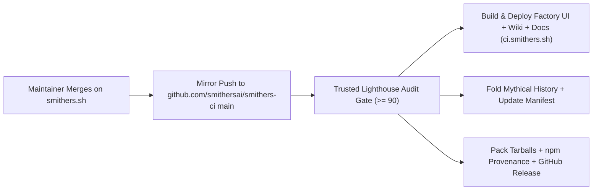

# GitHub Mirror, Automated Releases, and Docs Publishing

Smithers Cloud is the home where TODOs, stacked changesets, Lighthouse backpressure audits, and agent workflows live publicly. GitHub remains a first-class synchronized mirror so every open-source user and package consumer gets seamless updates.

## Automated Post-Merge Pipeline

1. **Trusted Audit Gate:** On every push to `main`, `.github/workflows/smithers-mirror-release.yml` runs the full strict typecheck, security tests, wiki check, `home.json` schema check, Mythical History verification, and Lighthouse Backpressure Audit.
2. **Shared Object Store Upload:** The verified JSON and HTML Lighthouse reports upload to the shared object store and attach to the GitHub Actions run summary.
3. **Docs, Wiki, and Factory UI Publish:** The React Factory UI, Obsidian wiki pages, `llms.txt`, and latest audit snapshot build and deploy automatically to Cloudflare (`ci.smithers.sh`) whenever `CLOUDFLARE_API_TOKEN` is configured.
4. **Release Automation:** Tagging a release or bumping `package.json` packs and publishes verified tarballs with npm provenance and creates a GitHub Release automatically.

## Community Pull Requests

Pull requests from forks trigger `.github/workflows/untrusted-pr-check.yml`, which never accesses write tokens or deploy secrets. It runs with read-only cache access, labels its audit report `UNTRUSTED COMMUNITY`, and invites a maintainer to run a controlled sandbox verification before merging.

## Related Pages

- [[trust-and-isolation]]
- [[shared-object-store]]
- [[lighthouse-backpressure]]
- [[index]]
