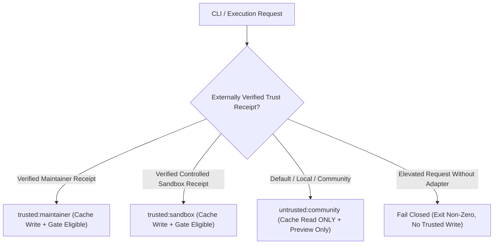

# Execution Trust and Isolation Model

Open source thrives when anyone can clone a repo, run tests, execute replays, and get fast feedback. We actively encourage non-maintainers to run untrusted executions locally and on pull requests. Most contributors are honest and deserve full warm-cache speedups.

At the same time, untrusted execution results must never poison the shared cache or skip required gates.

## Three Trust Tiers

| Tier | Who | Cache Read | Cache Write | Satisfy Merge/Release Gates |
| --- | --- | --- | --- | --- |
| `trusted:maintainer` | Externally verified repository maintainer receipt | Allowed | Allowed | Eligible |
| `trusted:sandbox` | Externally verified Smithers controlled sandbox receipt | Allowed | Allowed | Eligible |
| `untrusted:community` | Default local CLI run, any non-maintainer, fork PR, or unattested host | Allowed | Hard Blocked | Hard Blocked (`untrusted_preview`) |

## Fail-Closed CLI Elevation

Normal `bun run audit` and `bun run replay` invocations always default to `untrusted:community` bound to the real checkout identity. Local self-signing and ambient shared secrets are never accepted to elevate CLI provenance. Requesting `trusted:sandbox`, `trusted:maintainer`, or `--trust-receipt` fails closed in this repository until a production external trust-receipt verification adapter is integrated.

## Person-Only Guardrails

Even a maintainer agent or sandbox cannot execute person-only actions. Merging pull requests (`pr/merge`), committing TODOs (`todo/commit`), publishing releases (`release/publish`), and writing secrets (`secrets/write`) always return `403 person_only` for agent and sandbox credentials.

## Related Pages

- [[shared-object-store]]
- [[mcp-and-one-time-auth]]
- [[lighthouse-backpressure]]
- [[index]]
