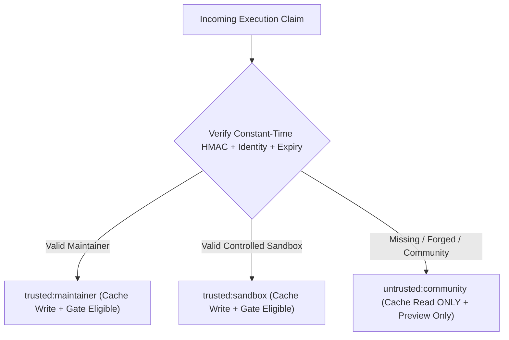

# Execution Trust and Isolation Model

Open source thrives when anyone can clone a repo, run tests, execute replays, and get fast feedback. We actively encourage non-maintainers to run untrusted executions locally and on pull requests. Most contributors are honest and deserve full warm-cache speedups.

At the same time, untrusted execution results must never poison the shared cache or skip required gates.

## Three Trust Tiers

| Tier | Who | Cache Read | Cache Write | Satisfy Merge/Release Gates |
| --- | --- | --- | --- | --- |
| `trusted:maintainer` | Verified repository maintainer (`roninjin10`) | Allowed | Allowed | Eligible |
| `trusted:sandbox` | Attested Smithers Cloudflare Sandbox or controlled host | Allowed | Allowed | Eligible |
| `untrusted:community` | Any non-maintainer, fork PR, or unattested local run | Allowed | Hard Blocked | Hard Blocked (`untrusted_preview`) |

## Person-Only Guardrails

Even a maintainer's agent or sandbox cannot execute person-only actions. Merging pull requests (`pr/merge`), committing TODOs (`todo/commit`), publishing releases (`release/publish`), and writing secrets (`secrets/write`) always return `403 person_only` for agent and sandbox credentials.

## Related Pages

- [[shared-object-store]]
- [[mcp-and-one-time-auth]]
- [[lighthouse-backpressure]]
- [[index]]
